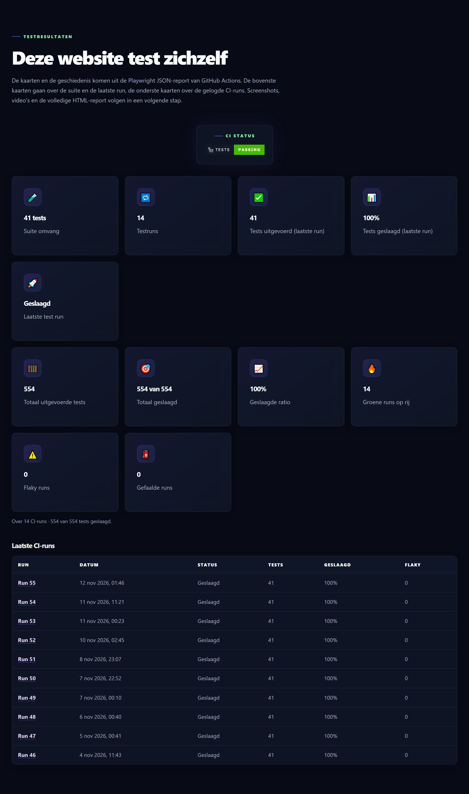
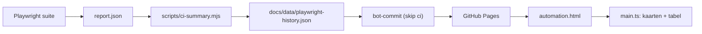

# Maarten Kamps — QA Engineer & Test Automation

[](https://github.com/MaartenKa/Portfolio/actions/workflows/playwright.yml)
[](https://maartenka.github.io/Portfolio/)
[](https://www.typescriptlang.org/)
[](https://playwright.dev/)
[](LICENSE)

**Live:** [maartenka.github.io/Portfolio](https://maartenka.github.io/Portfolio/) · **Dashboard:** [automation.html](https://maartenka.github.io/Portfolio/automation.html)

Een statische portfolio-website zonder backend of framework, met daarnaast een
Playwright-suite die diezelfde site test. Wat dit project onderscheidt: de site
**rapporteert over haar eigen tests**. Elke CI-run levert een JSON-rapport dat wordt
samengevat tot een CI-history en op `automation.html` als dashboard wordt getoond —
met pass-rate, groene streaks en de status van de laatste runs.

## In één oogopslag

| Kenmerk                | Waarde                                              |
| ---------------------- | --------------------------------------------------- |
| Testsuite              | **41 tests** in 5 spec-bestanden                    |
| Browser                | Chromium (Desktop Chrome)                           |
| Laatste gelogde CI-run | **41/41 geslaagd** (100%)                           |
| CI                     | GitHub Actions — dagelijks om 18:17 UTC + handmatig |
| Kwaliteitspoorten      | `tsc --noEmit`, ESLint 10, html-validate            |
| Stack                  | HTML/CSS, TypeScript, Playwright 1.65, GitHub Pages |
| Licentie               | MIT                                                 |

## Wat dit project laat zien

- **Testdesign** — positieve én negatieve paden, boundary-cases op formuliervelden,
  en asserts op zichtbaarheid, attributen en URL's.
- **Structuur** — Page Object Model met `base.page.ts` als basis, gedeelde testdata
  en herbruikbare fixtures.
- **CI/CD** — kwaliteitspoorten vóór de suite, daarna artifacts en een
  geautomatiseerde history-update.
- **Rapportage** — Playwright HTML- en JSON-reports, samengevat tot een CI-dashboard.
- **Toegankelijke markup** — skip-link, `aria`-attributen en `data-testid`-haken,
  bewaakt door een strikte HTML-validator.

## Het dashboard



De pagina `automation.html` leest `docs/data/playwright-history.json` en toont de
laatste 10 runs, plus gepoolde cijfers over de laatste 30 runs.

## Quick start

Vereist Node.js **>= 24.8 < 25** (zie `engines.node`; de CI leest dezelfde grens via
`node-version-file: package.json`).

```bash
npm ci                    # dependencies, exact uit package-lock.json
npx playwright install    # Chromium voor lokale runs
npm run build             # site-JS → docs/js/ts + typecheck van alle TS
npm run test:local        # suite tegen de lokale docs/ op poort 8080
npm run test              # suite tegen de live GitHub Pages-site
npm run check             # typecheck + lint + HTML-validatie
```

Werk je aan `docs/`? Gebruik `npm run test:local`. De standaardsuite draait tegen de
live site, die je wijziging nog niet heeft.

## Architectuur van de CI-history



Geen backend, geen database, geen API-tokens — alleen een JSON-bestand in de repo.
Details per schakel staan in [CI-PLAYWRIGHT-HISTORY.md](Project-documentation/CI-PLAYWRIGHT-HISTORY.md).

## Projectstructuur

```
docs/                          # statische site, root van GitHub Pages (10 pagina's)
  data/playwright-history.json   # CI-history die het dashboard leest
  js/ts/main.js                  # gebouwd bestand — niet met de hand aanpassen
src/ts/main.ts                 # bron van de site-JS (menu + CI-history UI)
playwright/
  pages/                       # Page Objects
  tests/smoke|functional/      # de 41 tests
  tests/accessibility|compatibility|e2e|regression/   # gereserveerd, nog leeg
scripts/ci-summary.mjs         # JSON-report → CI-history
Project-documentation/         # testplan, CI-documentatie, best practices
```

## Testsuite

| Suite            | Spec-bestand                                                 |  Tests |
| ---------------- | ------------------------------------------------------------ | -----: |
| Smoke            | `playwright/tests/smoke/smoke.spec.ts`                       |      9 |
| Homepage         | `playwright/tests/functional/homepage-functional.spec.ts`    |      5 |
| Contactformulier | `playwright/tests/functional/contact-functional.spec.ts`     |     10 |
| Mobiel menu      | `playwright/tests/functional/mobile-menu-functional.spec.ts` |     12 |
| CI-history UI    | `playwright/tests/functional/ci-history-functional.spec.ts`  |      5 |
| **Totaal**       | 5 spec-bestanden                                             | **41** |

## Kwaliteitspoorten

| Commando                | Wat het doet                                                       |
| ----------------------- | ------------------------------------------------------------------ |
| `npm run typecheck`     | `tsc --noEmit` — TypeScript strict                                 |
| `npm run lint`          | ESLint 10 inclusief `eslint-plugin-playwright`, `--max-warnings=0` |
| `npm run validate:html` | html-validate over `docs/**/*.html`                                |
| `npm run check`         | alle drie achter elkaar                                            |

Dezelfde drie poorten draaien in `playwright.yml` vóór de browserinstall en de tests:
een rode poort stopt de suite.

## Documentatie

| Document                                                                         | Beantwoordt                                         |
| -------------------------------------------------------------------------------- | --------------------------------------------------- |
| [PLAYWRIGHT.md](Project-documentation/PLAYWRIGHT.md)                             | Projectopbouw, Page Objects, conventies, commando's |
| [TESTPLAN.md](Project-documentation/TESTPLAN.md)                                 | Teststrategie, testmatrix G1–G13, roadmap           |
| [BESTPRACTICES.md](Project-documentation/BESTPRACTICES.md)                       | ISTQB- en Playwright-methodiek                      |
| [CI-OVERVIEW.md](Project-documentation/CI-OVERVIEW.md)                           | CI/CD in gewoon taalgebruik + bestandsgids          |
| [CI-PLAYWRIGHT-HISTORY.md](Project-documentation/CI-PLAYWRIGHT-HISTORY.md)       | Technische CI-spec: schema's en verificatie         |
| [PLAN-CI-HISTORY-TESTS.md](Project-documentation/PLAN-CI-HISTORY-TESTS.md)       | Testplan voor de CI-history tests                   |
| [PLAN-DEPENDENCY-UPGRADES.md](Project-documentation/PLAN-DEPENDENCY-UPGRADES.md) | Versiebeleid en upgrade-reeks                       |

## Beperkingen (eerlijk benoemd)

- **Live-site-afhankelijk.** De standaardsuite draait tegen GitHub Pages; nieuwe
  UI-tests slagen pas na deploy en de Pages-cache (tot 10 minuten). Daarom bestaat
  `npm run test:local`, dat tegen de lokale `docs/` draait.
- **Non-functionele suites zijn nog niet gebouwd.** `accessibility/`, `compatibility/`,
  `e2e/` en `regression/` zijn gereserveerd; A11Y-, SEO-, LINK- en
  compatibiliteitstests staan als fase 4–7 in het testplan.
- **De producerende kant is ongetest.** `scripts/ci-summary.mjs` heeft geen eigen
  geautomatiseerde test; de weergavelaag is wél gedekt door vijf UI-tests met gemockte
  data. De kaart "Suite omvang" is voorlopig een proxy (`max(total)`).

## Contact & licentie

- E-mail: <Maarten.kamps.bee@outlook.com>
- LinkedIn: <https://www.linkedin.com/in/maarten-kamps-a6909527/>
- GitHub: <https://github.com/MaartenKa/Portfolio>
- Licentie: MIT — zie [LICENSE](LICENSE)
