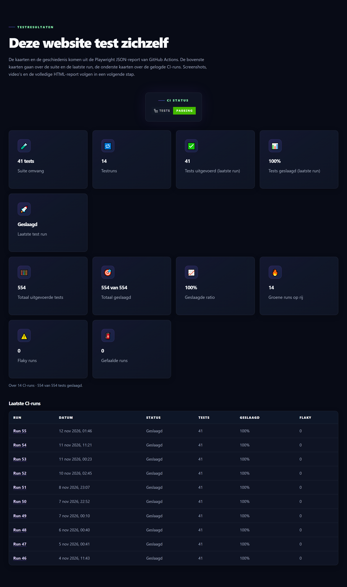
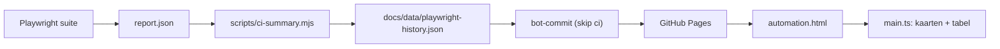

# Maarten Kamps — QA Engineer & Test Automation

[](https://github.com/MaartenKa/Portfolio/actions/workflows/playwright.yml)
[](https://maartenka.github.io/Portfolio/)
[](https://www.typescriptlang.org/)
[](https://playwright.dev/)
[](LICENSE)

**Live:** [maartenka.github.io/Portfolio](https://maartenka.github.io/Portfolio/) · **Dashboard:** [automation.html](https://maartenka.github.io/Portfolio/automation.html)

Een statische portfolio-website zonder backend of framework, met daarnaast een
Playwright-suite die diezelfde site test. Wat dit project onderscheidt: de site
**rapporteert over haar eigen tests**. Elke CI-run levert een JSON-rapport dat wordt
samengevat tot een CI-history en op `automation.html` als dashboard wordt getoond —
met pass-rate, groene streaks en de status van de laatste runs.

## In één oogopslag

| Kenmerk                | Waarde                                              |
| ---------------------- | --------------------------------------------------- |
| Testsuite              | **148 tests** in 12 spec-bestanden (139 browser + 9 datasuite) |
| Browser                | Chromium (Desktop Chrome)                           |
| Laatste gelogde CI-run | **139/139 geslaagd** (run 73, 100%; de 139-suite draaide groen in de CI, na de CSS-fix die de vier RESP-01-cases van run 72 ophefte; de 148-suite met CIH-07 is nog niet in de CI bewezen) |
| CI                     | GitHub Actions — dagelijks om 18:17 UTC + handmatig |
| Kwaliteitspoorten      | `tsc --noEmit`, ESLint 10, html-validate, `test:ci-summary` (CIH-06) |
| Stack                  | HTML/CSS, TypeScript, Playwright 1.65, GitHub Pages |
| Licentie               | MIT                                                 |

## Wat dit project laat zien

- **Testdesign** — positieve én negatieve paden, boundary-cases op formuliervelden,
  en asserts op zichtbaarheid, attributen en URL's.
- **Structuur** — Page Object Model met `base.page.ts` als basis, gedeelde testdata
  en herbruikbare fixtures.
- **Gebruikersflows (E2E)** — zes flows op de pyramide-kern: de navigatietour, de
  contactjourney, het mobiele menu, het CI-dashboard, de footer en de 404-herstelroute
  — met landingschecks op URL én `h1` (`playwright/tests/e2e/e2e.spec.ts`).
- **Non-functionele dekking** — accessibility (toetsenbord, landmarks, alt-teksten,
  contrast), responsive meetbare checks op de echte CSS-grenzen, SEO (canonical,
  Open Graph, Twitter card, sitemap, robots) en content-integriteit van interne links,
  externe link-attributen en asset-referenties.
- **CI/CD** — kwaliteitspoorten vóór de suite, daarna artifacts en een
  geautomatiseerde history-update.
- **Rapportage** — Playwright HTML- en JSON-reports, samengevat tot een CI-dashboard.
- **Toegankelijke markup** — skip-link, `aria`-attributen en `data-testid`-haken,
  bewaakt door een strikte HTML-validator én door de accessibility-suite
  (tabvolgorde, focus-indicator, skip-link-focus, `lang`, landmarks, `alt`-teksten,
  gemeten placeholder-contrast en `forced-colors`-fallback).

## Het dashboard



De pagina `automation.html` leest `docs/data/playwright-history.json` en toont de
laatste 10 runs, plus gepoolde cijfers over de laatste 30 runs.

## Quick start

Vereist Node.js **>= 24.8 < 25** (zie `engines.node`; de CI leest dezelfde grens via
`node-version-file: package.json`).

```bash
npm ci                    # dependencies, exact uit package-lock.json
npx playwright install    # Chromium voor lokale runs
npm run build             # site-JS → docs/js/ts + typecheck van alle TS
npm run test:local        # suite tegen de lokale docs/ op poort 8080
npm run test:localVideo   # dezelfde suite in de kijkmodus: video/trace van élke run
npm run test:ci-summary   # datasuite op scripts/ci-summary.mjs (9 tests, zonder browser)
npm run check:site        # live pagina's vooraf op HTTP 200 controleren
npm run test              # suite tegen de live GitHub Pages-site
npm run check             # typecheck + lint + HTML-validatie
```

Werk je aan `docs/`? Gebruik `npm run test:local`. De standaardsuite draait tegen de
live site, die je wijziging nog niet heeft.

## Architectuur van de CI-history



Geen backend, geen database, geen API-tokens — alleen een JSON-bestand in de repo.
Details per schakel staan in [CI-PLAYWRIGHT-HISTORY.md](Project-documentation/CI-PLAYWRIGHT-HISTORY.md).

## Projectstructuur

```
docs/                          # statische site, root van GitHub Pages (10 pagina's)
  data/playwright-history.json   # CI-history die het dashboard leest
  js/ts/main.js                  # gebouwd bestand — niet met de hand aanpassen
src/ts/main.ts                 # bron van de site-JS (menu + CI-history UI)
playwright/
  pages/                       # Page Objects
  fixtures/test-fixtures.ts    # typed Page Object-fixtures
  fixtures/formward.mock.ts    # Formward-mock + request-registratie
  utils/test-data.ts           # gedeelde constanten + formulierdatasets
  tests/smoke|functional/      # 63 tests (smoke + functioneel)
  tests/accessibility/accessibility.spec.ts  # A11Y-01…A11Y-04, 17 tests
  tests/compatibility|e2e|regression/        # gereserveerd, nog leeg
  tests/unit/ci-summary.spec.ts              # CIH-06/07: 9 datasuite-tests op ci-summary.mjs
scripts/ci-summary.mjs         # JSON-report → CI-history
scripts/site-check.mjs         # live-site-preflight vóór de tests
Project-documentation/         # testplan, CI-documentatie, best practices, verbeterplan
```

## Testsuite

| Suite            | Spec-bestand                                                 |  Tests |
| ---------------- | ------------------------------------------------------------ | -----: |
| Smoke            | `playwright/tests/smoke/smoke.spec.ts`                       |     10 |
| Homepage         | `playwright/tests/functional/homepage-functional.spec.ts`    |     12 |
| Contactformulier | `playwright/tests/functional/contact-functional.spec.ts`     |     16 |
| Mobiel menu      | `playwright/tests/functional/mobile-menu-functional.spec.ts` |     17 |
| CI-history UI    | `playwright/tests/functional/ci-history-functional.spec.ts`  |      7 |
| Footer           | `playwright/tests/functional/footer-functional.spec.ts`      |      3 |
| Accessibility    | `playwright/tests/accessibility/accessibility.spec.ts`       |     17 |
| Content-integrity | `playwright/tests/content-integrity/content-integrity.spec.ts` |     11 |
| SEO              | `playwright/tests/seo/seo.spec.ts`                          |     32 |
| Responsive       | `playwright/tests/responsive/responsive.spec.ts`            |      8 |
| E2E-gebruikersflows | `playwright/tests/e2e/e2e.spec.ts` (S1–S6)               |      6 |
| CIH-06/07 datasuite | `playwright/tests/unit/ci-summary.spec.ts` (zonder browser)  |      9 |
| **Totaal**       | 12 spec-bestanden                                            | **148** |

## Kwaliteitspoorten

| Commando                | Wat het doet                                                       |
| ----------------------- | ------------------------------------------------------------------ |
| `npm run typecheck`     | `tsc --noEmit` — TypeScript strict                                 |
| `npm run lint`          | ESLint 10 inclusief `eslint-plugin-playwright`, `--max-warnings=0` |
| `npm run validate:html` | html-validate over `docs/**/*.html`                                |
| `npm run check`         | de drie hierboven achter elkaar                                    |
| `npm run test:ci-summary` | datasuite CIH-06/07 op `scripts/ci-summary.mjs` (9 tests, zonder browser) |

De poorten draaien in `playwright.yml` vóór de browserinstall en de tests: de drie
checks uit `npm run check`, dan de datasuite van CIH-06. Een rode poort stopt de
suite; de datasuite heeft geen browser nodig, dus hij faalt vóór de download.

## Documentatie

| Document                                                                         | Beantwoordt                                         |
| -------------------------------------------------------------------------------- | --------------------------------------------------- |
| [PLAYWRIGHT.md](Project-documentation/PLAYWRIGHT.md)                             | Projectopbouw, Page Objects, conventies, commando's |
| [TESTPLAN.md](Project-documentation/TESTPLAN.md)                                 | Teststrategie, testmatrix G1–G13, roadmap           |
| [TEST-SUITE-STATUS.md](Project-documentation/TEST-SUITE-STATUS.md)               | Actuele backlog: wat gedaan is en wat nog open is   |
| [PLAN-HERO-SOFT-3D.md](Project-documentation/PLAN-HERO-SOFT-3D.md)               | Plan en resultaat van de soft-3D homepage-card     |
| [BESTPRACTICES.md](Project-documentation/BESTPRACTICES.md)                       | ISTQB-, Playwright-methodiek en commentaarconventies |
| [CI-OVERVIEW.md](Project-documentation/CI-OVERVIEW.md)                           | CI/CD in gewoon taalgebruik + bestandsgids          |
| [CI-PLAYWRIGHT-HISTORY.md](Project-documentation/CI-PLAYWRIGHT-HISTORY.md)       | Technische CI-spec: schema's en verificatie         |
| [PLAN-CI-HISTORY-TESTS.md](Project-documentation/PLAN-CI-HISTORY-TESTS.md)       | Testplan voor de CI-history tests                   |
| [PLAN-DEPENDENCY-UPGRADES.md](Project-documentation/PLAN-DEPENDENCY-UPGRADES.md) | Versiebeleid en upgrade-reeks                       |

## Beperkingen (eerlijk benoemd)

- **Live-site-afhankelijk.** De standaardsuite draait tegen GitHub Pages; nieuwe
  UI-tests slagen pas na deploy en de Pages-cache (tot 10 minuten). Daarom bestaat
  `npm run test:local`, dat tegen de lokale `docs/` draait. Een 5xx/timeout van de
  host wordt door `npm run check:site` vóór de suite afgevangen en geldt als
  infrastructuurprobleem, niet als testflake.
- **De layout is font-metric-gevoelig.** De responsive-suite (RESP-01) meet de
  documentbreedte, en die hangt af van de glyphbreedtes van de system-uitvalfont. De
  runner heeft een bredere uitvalfont dan de lokale "Segoe UI", dus kan de min-content
  van een lange, onbreekbare tekst (een h1, een h2, een URL) breder zijn dan de kolom —
  dan loopt de pagina horizontaal op een smalle viewport. De site-CSS breekt lange
  woorden en URLs (`overflow-wrap: break-word` op `body`), en de hertest draait lokaal
  met een wide-font proxy op de lokale `docs/`-build. In run 72 faalden vier RESP-01-cases
  op de runner vóór die fix; na de fix is run 73 groen met **139/139** op dezelfde runner,
 met alle CI-stappen success.
- **Non-functionele suites zijn nu gebouwd voor responsive, SEO en content-integriteit.**
  De accessibility-suite (A11Y-01…A11Y-04, 17 tests), de responsive-suite (RESP-01, 8 tests
  op 7 viewports, inclusief de CSS-grenzen 850/849 en 500/499), de SEO-suite (SEO-01…04,
  32 tests) en de content-integriteit-suite (LINK-01, LINK-02, IMG-01, 11 tests) draaien in
  Chromium met eigen DOM-asserts. axe-core en Lighthouse zijn niet opgenomen
  (`package.json` heeft geen extra dependency), dus screenreader-gedrag en
  performance-meting blijven handmatig; visual baselines (VIS-01) staan als fase 5 in het
  testplan. De E2E-laag is gebouwd (zes flows S1–S6, `playwright/tests/e2e/e2e.spec.ts`);
  `compatibility/` en `regression/` zijn nog gereserveerd.
- **De producerende kant heeft nu eigen tests.** `scripts/ci-summary.mjs` draait in
  de datasuite CIH-06/07: 9 tests in `playwright/tests/unit/ci-summary.spec.ts`, in de
  Playwright-runner zonder browser, via `npm run test:ci-summary` als CI-poort vóór de
  browserinstall. De weergavelaag is gedekt door zeven UI-tests met gemockte data. De
  kaart "Suite omvang" gebruikt `suiteTests` uit schema v2 van de JSON-report, met
  `max(total)` als valback voor schema v1-entries zonder `suiteTests` (CIH-07).

## Contact & licentie

- E-mail: <Maarten.kamps.bee@outlook.com>
- LinkedIn: <https://www.linkedin.com/in/maarten-kamps-a6909527/>
- GitHub: <https://github.com/MaartenKa/Portfolio>
- Licentie: MIT met bekerking zie [LICENSE](LICENSE)
